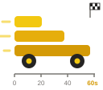

  

# DoneIn60seconds

Solving common Power BI challenges in less than 60 seconds: deterministic, token free and model-independent.

This repository holds the Tabular Editor macros, Semantic Link Labs notebooks and session material behind the *Done in 60 seconds* community sessions. The content covers time intelligence, calendars, DAX User-Defined Functions (UDFs), PBIR report automation, usage analysis and cleanup, best-practice analysis, AI readiness and master models.

---

## TE macros — TE3

Current macros for **Tabular Editor 3**, grouped by topic. Most of them use TE3 features such as DAX UDFs and Calendars, and the PBIR macros edit report files in a PBIP project on disk.

> [!WARNING]
> **The PBIR macros are experimental for now.** This covers every macro that reads or edits PBIR report files: `00 Info/PBIR`, `06 Report (PBIR)`, `07 Usage and cleanup` and `Perspective from report.cs`. Run them on a copy of the project or under source control, and check the report in Power BI Desktop afterwards.

### 00 Info

| File | Purpose |
|------|---------|
| `BPA/Export BPA results.cs` | Exports Best Practice Analyzer results (based on m-kovalsky's script) |
| `BPA/Export BPA rules.cs` | Exports the BPA rules in use |
| `BPA/Load BPA rules - Analysis Services.cs` | Loads a BPA rule set into the model |
| `PBIR/List Fabric App usage.cs` | Read-only overview of which measures and columns Fabric Apps query from the model |
| `PBIR/Organize columns by usage (PBIR).cs` | Puts columns in display folders by how they are used in reports and the model |
| `PBIR/Organize measures by usage (PBIR and Fabric Apps).cs` | Puts measures in display folders by how they are used in PBIR reports and Fabric Apps |

### 01 Tables

| File | Purpose |
|------|---------|
| `Create a formatted date table with calendar options.cs` | Creates a calendar table, marks it as a date table and configures Gregorian and ISO/weekly calendar options in one run |

### 02 DaxUDF

| File | Purpose |
|------|---------|
| `Generate Time Intelligence DaxUDF.cs` | Generates time intelligence UDFs (accumulated, moving totals and averages, semi-additive, date filtering), in date-column or Calendar mode |
| `Rank by selected columns DaxUDF.cs` | Ranking UDFs for a base measure by one or more selected columns |
| `Create Pareto Analysis DaxUDF - model independent.cs` | Model-independent UDFs for the dynamic Pareto analysis pattern |
| `Conditional formatting by thresholds DaxUDF.cs` | UDFs for background colour, font colour and good/bad/neutral flags based on thresholds |
| `Error bars for actual vs target DaxUDF.cs` | UDFs that drive error bars comparing an actual measure with a target |
| `Create Visual calculation axis DaxUDF.cs` | UDFs that set a dynamic axis min/max in visual calculations |

### 03 Calculation Groups

| File | Purpose |
|------|---------|
| `Dynamic axis from slicer selection.cs` | Creates or updates a "Period to show" calculation group built on DAX UDFs |

### 04 Measures

| File | Purpose |
|------|---------|
| `Create measure from model dependent functions.cs` | Creates measures for selected base measures from the model-dependent UDFs, using their suffix and folder annotations |
| `Compare first selected measure with second selected measure DaxUDF.cs` | Creates comparison measures between two selected measures |

### 06 Report (PBIR) (experimental)

| File | Purpose |
|------|---------|
| `Rename measures (TOM + PBIR sync).cs` | Renames measures in the model and updates every reference in the PBIR report files |
| `Batch replace PBIR table column and measure references.cs` | Replaces table, column and measure references across the model and one or more reports |
| `Detect and repair broken PBIR references.cs` | Finds report references that no longer exist in the model and repairs them |
| `Replace field in visuals (PBIR).cs` | Swaps one measure or column for another in report visuals without changing the model |
| `Set display names for selected fields in PBIR.cs` | Sets explicit display names for selected fields across reports |
| `Batch rename existing display names in PBIR.cs` | Standardizes existing display names by their underlying field |

### 07 Usage and cleanup

| File | Purpose |
|------|---------|
| `Classify model dependencies from PBIR and Fabric Apps.cs` | Read-only overview of how the model is used by reports and Fabric Apps |
| `Merge duplicate measures (PBIR and Fabric Apps).cs` | Finds measures with the same DAX, keeps one and repoints reports and Fabric Apps |

### 08 Master models

| File | Purpose |
|------|---------|
| `Master model - create or update perspective models.cs` | Builds smaller semantic models from the perspectives of one master model (PBIP) |
| `Perspective from report.cs` | Creates a perspective with exactly the fields one or more PBIR reports use |

### 09 Documentation

| File | Purpose |
|------|---------|
| `Create model documentation (Info.view).cs` | Creates a calculated documentation table from the INFO views |

---

## Semantic Link Labs

Resources for running analysis and administration at scale with the [Semantic Link Labs](https://github.com/microsoft/semantic-link-labs) Python library inside Microsoft Fabric.

| File | Purpose |
|------|---------|
| `BPA/Fabric Februay - SLL BPA demo Shared.ipynb` | Fabric notebook demonstrated at the Fabric February community event. Runs BPA rules across one or more semantic models and writes results to a Lakehouse table. |
| `BPA-SemanticLinkLabsReport/` | Power BI Enhanced Report (PBIR) for visualising the BPA results produced by the notebook above. |
| `nb_Copilot_model_settings_editor.py` | Fabric Python notebook that turns *Copilot and MCP tools for readers* and *Approved for Copilot* on or off per semantic model, and shows whether each model is prepped for AI (AI instructions, AI schema, verified answers or a data agent). Needs write permission on the model; it uses an undocumented endpoint, so test on one model first. |

---

## Conferences

Scripts and slides from earlier sessions are in `TE macros/Conferences/`.

- **New Stars of Data 2025** (May 16, 2025): introductory session on Tabular Editor automation, with scripts for date tables, time intelligence calculation groups, measures and model formatting. The scripts work with the free **Tabular Editor 2**, and `MacroActions.json` registers all of them as macros.
- **Data Toboggan, Summer 2025** (July 12, 2025): intelligent time intelligence with calculation groups and Calendars. Includes C# scripts, TMDL snippets and the slide deck.

---

## Getting started

1. **Tabular Editor 3**: open any `.cs` file from `TE macros/TE3/` in the TE3 script editor and run it, or save it as a macro.
2. **Tabular Editor 2 (free)**: import `MacroActions.json` from `TE macros/Conferences/New Stars of Data 2025/` via *Macros → Manage Macros → Import*.
3. **Semantic Link Labs notebooks**: upload the notebook to a Fabric workspace, attach a Lakehouse where needed, set the parameters and run all cells.
