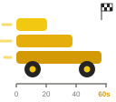

# Logo sketches

The old Power BI bars, turned sideways and stacked into a wedge-shaped race car. The x-axis is development time, and the longest bar finishes at 60 seconds.

| | A: car | B: car on time axis (chosen) | C: icon / favicon |
|---|---|---|---|
| Large | { width="200" } | { width="200" } | { width="150" } |
| Header size | { width="32" } | { width="32" } | { width="24" } |
